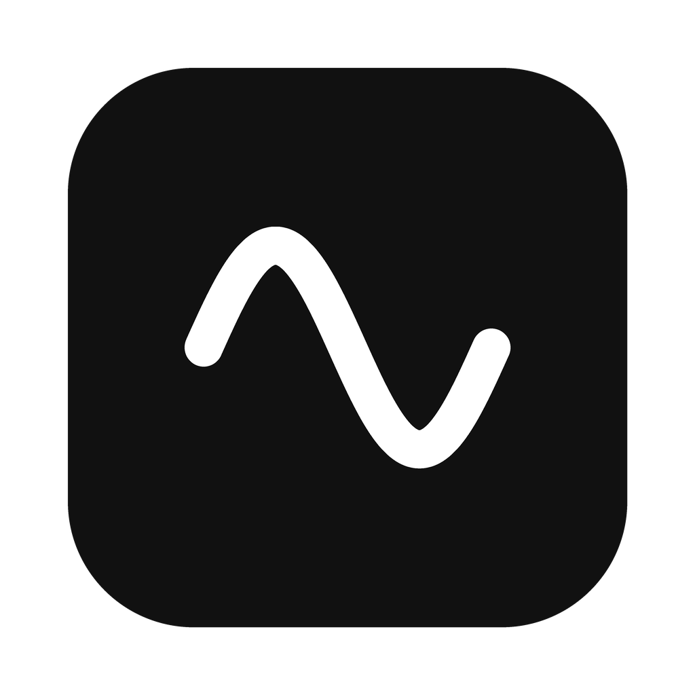

<p align="center"></p>

<h1 align="center">Phono</h1>

Dictation for macOS that runs entirely on your Mac. Hold ⌥ Option, speak, and let go. The text is typed where your cursor is.

Phono runs [Phonon-2](https://huggingface.co/FermionResearch/Phonon-2), an English speech model, on the Mac's Neural Engine. It is one small native app and one model file: no Python, no account, no network.

## Phono and Detta

[Detta](https://www.fermionresearch.com/products/detta/) is Fermion Research's own dictation app for Phonon-2. It does more: it removes filler words, formats numbers and dates, saves Quick Notes, and transcribes video files. Phono does one thing: it turns speech into text.

| | Phono | Detta 1.0.26 |
|---|---|---|
| Download and install | 345 MB model, 0.4 MB app | 1.3 GB app |
| What it installs | the app and Phonon-2 | the app, Phonon-2, Python 3.12 with 45 packages, and a second AI model for text clean-up |
| Account | none | Google sign-in |
| Your recordings | never leave your Mac | shared with Fermion by default, unless you turn it off |
| Network after install | none | update check every hour |
| macOS | 15 or later | 26.2 or later |
| Source | about 1,700 lines of Swift, MIT | closed |

Both apps run the same Phonon-2 model file on the Neural Engine, so the accuracy is the same: 5.21% word error on the Open ASR Leaderboard. On the first launch, Core ML also stores a compiled copy of the model for your Mac. For Phono it is about 300 MB. To compare disk and memory on your own Mac, open both apps and run `./Scripts/stats.sh Detta`.

## Requirements

- A Mac with Apple silicon, macOS 15 or later
- Xcode Command Line Tools: `xcode-select --install`

## Install

```sh
git clone https://github.com/eriko13/Phono.git
cd Phono
./Scripts/install.sh
```

The script downloads the model (345 MB), builds Phono, copies it to `/Applications`, and opens it. Then:

1. Allow microphone access.
2. Allow Phono in **System Settings › Privacy & Security › Accessibility**. Phono needs this to see the Option key and to paste or type the text.
3. Wait until the menu-bar wave is no longer dimmed. On the first launch, macOS prepares the model for your Mac. This takes a minute or two and happens once.

To update, run `git pull` and `./Scripts/install.sh` again. macOS treats each build as a new app, so remove the old Phono entry from the Accessibility list and allow the new one.

## Use

Hold **⌥ Option** and speak. Release it, and the text appears in the active app. Phono puts back whatever was on your clipboard.

Option is also part of other shortcuts, such as ⌥←. If you press another key or click while you hold Option, Phono discards the recording, so those shortcuts work as usual.

Settings are in the menu-bar menu:

- **Mode**: hold to talk, or press once to start and again to stop.
- **Shortcut**: ⌥ Option, Right ⌥ Option, fn, or a key combination such as ⌃⌥Space. If you choose fn, set **Keyboard › Press 🌐 key to** to **Do Nothing**.
- **Output**: how the text gets to the active app.
  - **Paste** (default): Phono pastes the text with ⌘V, then puts back your clipboard.
  - **Type**: Phono types the text one character at a time. Use it where paste does not work, such as in apps or web forms that block paste. Your clipboard does not change. Long text takes a second or two.
  - **Copy only**: Phono puts the text on the clipboard.
- **Recent**: your last 10 transcripts. Click one to copy it again.

### Command line

```sh
/Applications/Phono.app/Contents/MacOS/phono transcribe meeting.m4a
/Applications/Phono.app/Contents/MacOS/phono status
```

`transcribe` reads wav, m4a, mp3, aiff, caf, and flac files of any length. Phono does not need to be running.

### Use a server instead of this Mac

Phono can send each clip to a Phonon server, such as a Linux machine with an NVIDIA GPU, and paste the text that comes back. It is the same Phonon-2 model, so the text is the same. Your audio leaves your Mac, but only for the server you set.

1. On the server, start Fermion's CUDA image with an API key. It needs Docker and the NVIDIA Container Toolkit.

   ```sh
   mkdir -p ~/.config/phonon && echo "PHONON_API_KEY=$(openssl rand -hex 24)" > ~/.config/phonon/env
   docker run -d --name phonon --restart unless-stopped --gpus all \
     --env-file ~/.config/phonon/env -v phonon-cache:/home/phonon/.cache \
     -p 100.x.y.z:8000:8000 ghcr.io/fermionresearch/phonon-cuda:1.0.6 \
     serve --model phonon-2 --host 0.0.0.0 --port 8000
   ```

   Replace `100.x.y.z` with the server's Tailscale IP, so only your tailnet can reach it. For a server without a GPU, use `ghcr.io/fermionresearch/phonon-cpu:2.0.7` and drop `--gpus all`.
2. On the Mac, point Phono at it:

   ```sh
   /Applications/Phono.app/Contents/MacOS/phono server http://overmn:8000 <key>
   ```

3. Quit and reopen Phono. The menu shows **Phonon-2 on overmn**.

**Engine** in the menu switches between the server and this Mac. `phono server off` switches back from the command line. Use the server's short name (`overmn`) or its IP address: the app allows plain http only on the local network. The key is stored in Phono's preferences, in plain text. `phono transcribe` always runs on this Mac.

## Troubleshooting

| Problem | Fix |
|---|---|
| The menu says the model is not downloaded | Run `./Scripts/download-model.sh`, then choose **Load Phonon-2** in the menu. |
| Holding Option does nothing | Allow Phono in Accessibility. After a rebuild, remove the old entry first. |
| The text is copied but not pasted | The same Accessibility fix. |
| An app does not accept the pasted text | Set **Output** to **Type**. |
| The menu says the server failed | Check that `curl http://overmn:8000/health` answers, then choose **Reconnect**. |

## Uninstall

```sh
rm -rf /Applications/Phono.app ~/Library/Application\ Support/Phono ~/Library/Caches/phonon-coreml
defaults delete io.github.eriko13.phono
```

## Development

```sh
swift build            # the app and CLI
swift test             # tests for PhonoCore
./Scripts/bundle.sh    # build/Phono.app
```

[docs/ARCHITECTURE.md](docs/ARCHITECTURE.md) explains how the parts fit together. Pull requests are welcome. CI must pass.

## License

Phono is MIT licensed. It uses [phonon-coreml](https://github.com/fermionresearch/phonon-coreml) by Fermion Research (Apache-2.0). Phonon-2 is CC-BY-4.0, by Fermion Research, based on NVIDIA's parakeet-tdt-0.6b-v3. Phono does not include the model; the install script downloads it.
